# Informe de UI y UX — AloStudio ("The Hand-Bent Neon Room")

> **Fecha:** 2026-11-23 · **Rama:** `feat/neon-ux` · **Alcance:** Auditoría visual, de experiencia, accesibilidad, móvil y consistencia sobre `frontend/` sin modificar código.
> **Fuentes normativas:** `docs/design-neon/DESIGN.md`, `docs/design-neon/PRODUCT.md`, `docs/design-neon/neon-tokens.reference.scss`, `docs/design-neon/neon-surfaces.reference.scss` y `frontend/DESIGN-SYSTEM.md`.

---

## Resumen ejecutivo

La base del sistema neón (*The Hand-Bent Neon Room*) está bien plantada en escritorio: los paneles de vidrio marino (`--surface`), el contraste tipográfico de Geologica y el zumbido de la barra lateral le dan identidad propia y limpia frente a los dashboards genéricos.

Sin embargo, al recorrer la aplicación real en escritorio (`1440×900`) y celular (`390×844`) aparecen **14 oportunidades de mejora ordenadas por impacto**, encabezadas por cuatro problemas de impacto **crítico** que hoy degradan la experiencia real de uso:

1. **80 ocurrencias del bug de opacidad de Tailwind 3 en 47 archivos** (`bg-x/NN`, `border-x/NN`, `backdrop:bg-backdrop/75`): dejan fondos transparentes en badges de estado, resaltados de búsqueda, alertas, modales y el velo del cajón móvil.
2. **Experiencia móvil rota en la barra superior**: el cartel neón se recorta a 1–2 letras (`B...`, `C...`, `Aj...`) con el brillo cortado en caja, y el popover de Ayuda (`HelpButton`) se desborda **182 px fuera del borde izquierdo** de la pantalla.
3. **Pestañas de CRM apiladas en 3 filas en celular** con el tubo luminoso flotando sobre la segunda fila, y **29 ítems planos en Ajustes** (`3324 px` de scroll horizontal en móvil sin llevar el ítem activo a la vista).
4. **47 confirmaciones nativas `window.confirm()`** y **módulo de WhatsApp 100 % sin traducir** (rompen el tema oscuro, la accesibilidad y el soporte multi-idioma).

---

## 🔴 Impacto Crítico

### 1. Bug de Tailwind 3 con modificadores de opacidad (`bg-x/NN`, `border-x/NN`, `backdrop:bg-backdrop/75`) — 80 usos en 47 archivos

- **Categoría:** Consistencia con el sistema neón / Contraste y legibilidad.
- **Evidencia medida en DOM real:**
  - En `frontend/components/shell/dashboard-shell.tsx:208` (`bg-backdrop/80`), el velo detrás del cajón móvil computa `background-color: rgba(0, 0, 0, 0)` — la pantalla de fondo queda totalmente descubierta e iluminada.
  - En `frontend/components/contacts/contacts-view.tsx:369` (`bg-danger/10`), el badge `BLOQUEADO` computa `background-color: rgba(0, 0, 0, 0)` — queda solo texto rojo flotando sin pastilla.
- **Archivos y líneas afectadas (muestra representativa de los 47 archivos / 80 ocurrencias):**
  - Velo del cajón móvil y 8 diálogos `<dialog>`: `frontend/components/shell/dashboard-shell.tsx:208`, `frontend/components/agenda/appointment-dialog.tsx:225`, `frontend/components/closing/close-dialog.tsx:73`, `frontend/components/contacts/merge-dialog.tsx:95`, `frontend/components/crm/activity-dialog.tsx:145`, `frontend/components/crm/opportunity-dialog.tsx:162`, `frontend/components/crm/pipeline-dialog.tsx:131`, `frontend/components/instagram/connect-capabilities-dialog.tsx:55`, `frontend/components/publications/channels-panel.tsx:445`, `frontend/components/publications/publication-detail-dialog.tsx:183`.
  - Badges de estado sin fondo: `frontend/components/agenda/status-badge.tsx:21-36`, `frontend/components/publications/publication-state-badge.tsx:17-21`, `frontend/components/publications/publication-state-badge.tsx:67-69`, `frontend/components/help-center/articles-panel.tsx:35-36`, `frontend/components/campaigns/campaigns-view.tsx:135`, `frontend/components/campaigns/campaigns-view.tsx:160`, `frontend/components/settings/automation/automation-rules-view.tsx:126`, `frontend/components/settings/integrations/integrations-view.tsx:69-72`.
  - Resaltado de búsqueda invisible en Bandeja: `frontend/components/conversations/highlighted.tsx:18` (`bg-primary/25`), `frontend/components/conversations/chat-search.tsx:91` (`bg-primary/15`), `frontend/components/conversations/conversation-list.tsx:884` (`bg-primary/15`).
  - Alertas de auth y formularios sin relleno ni borde: `frontend/app/(auth)/forgot-password/page.tsx:47` (`border-success/40 bg-success/10`), `frontend/app/(auth)/reset-password/reset-form.tsx:60` (`border-danger/40 bg-danger/10`), `frontend/app/auth/sso/page.tsx:64`.
  - Hover invisible en tarjetas del Kanban CRM y dropzone de Medios: `frontend/components/crm/opportunities-view.tsx:301` (`hover:border-neon/60`), `frontend/components/publications/media-library-view.tsx:161` (`bg-focused/40`) y `:221` (`bg-backdrop/80`).
- **Por qué ocurre:** `frontend/tailwind.config.ts:13-43` define los colores como `"var(--neon-core)"` en lugar de canales RGB (`rgb(var(--neon-core-rgb) / <alpha-value>)`) o `color-mix()`. Tailwind 3 descarta silenciosamente cualquier sufijo `/NN`.
- **Cómo resolverlo:** Arreglo central en `frontend/app/globals.css` + `frontend/tailwind.config.ts` definiendo los canales RGB (o `color-mix(in srgb, var(--token) <alpha-value>, transparent)`), lo que repara las **80 instancias de una sola vez** sin tocar 47 componentes.

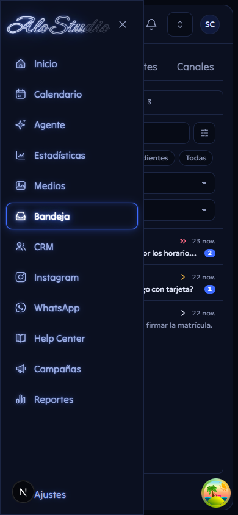

---

### 2. Barra superior saturada en celular: cartel neón mutilado (`B...`, `C...`, `Aj...`) y popover de Ayuda fuera de pantalla (`x = -182px`)

- **Categoría:** Accesibilidad y celular / Jerarquía y espaciado.
- **Dónde:**
  - `frontend/components/shell/dashboard-shell.tsx:241-270` (`<header>` con 6 controles en línea y `<h1 className="... max-lg:truncate">`).
  - `frontend/components/shell/help-button.tsx:211` (`absolute right-0 w-[24rem] max-w-[calc(100vw-2rem)]`).
  - `frontend/components/shell/notification-bell.tsx:95` (`absolute right-0 w-[22rem] max-w-[calc(100vw-2rem)]`).
- **Qué pasa hoy (medido en 390×844):**
  1. Los 6 botones (`Menú`, `Ayuda ?`, `Tema`, `Campana`, `Selector de cuenta`, `Avatar SC`) consumen casi todo el ancho y dejan solo **44 px** para el título `.neon-sign`. Resultado: *"Bandeja"* se lee **`B...`**, *"Contactos"* se lee **`C...`** y *"Ajustes"* se lee **`Aj...`**.
  2. Además `max-lg:truncate` aplica `overflow: hidden` al `<h1>`, **cortando el halo de neón en un rectángulo duro**, violando `docs/design-neon/DESIGN.md:274` (*"Its glow is allowed to overflow the title box"*).
  3. Como `HelpButton` está en el medio de la barra y abre su diálogo anclado a `right-0` de sí mismo con `width: 358px`, su borde izquierdo cae en **`x = -182 px`** — la mitad del asistente de ayuda queda literalmente afuera de la pantalla.
- **Cómo resolverlo:**
  - En `< sm`, mover `ThemeToggle` y `AccountSwitcher` adentro del cajón móvil (o al pie del menú de usuario) para que en la barra superior queden solo `Menú`, el cartel legible completo y `Notificaciones + Avatar` (o `?` + `Campana` con popover `fixed inset-x-3 top-16` en móvil).
  - En `< 1024px`, usar `text-[20px]` sin `overflow-hidden` sobre el resplandor (o padding vertical/horizontal generoso con máscara de desvanecimiento suave).

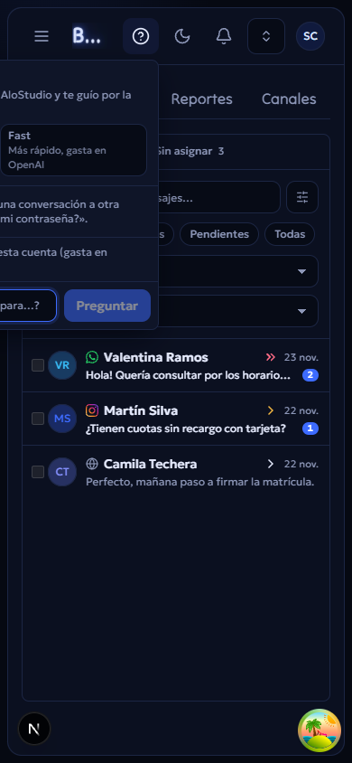

---

### 3. Pestañas de CRM en 3 filas en celular y 29 ítems planos en Ajustes

- **Categoría:** Celular / Navegación y arquitectura de información / Consistencia con `DESIGN.md`.
- **Dónde:**
  - `frontend/components/ui/tabs.tsx:55` y `:116` (`TabsList` y `NavTabs` usan `flex-wrap`).
  - `frontend/components/crm/crm-tabs.tsx:11-28` (6 pestañas: Contactos, Empresas, Oportunidades, Tareas, Productos, Agenda).
  - `frontend/components/settings/settings-sidebar.tsx:19-138` y `:196-242` (29 secciones en 2 grupos; tira horizontal de `3324 px` en móvil).
- **Qué pasa hoy:**
  - En CRM móvil (`390px`), `NavTabs` envuelve en **3 líneas**. El tubo luminoso `.neon-tab-active::after` (`bottom: -1px`) queda **flotando en el aire entre la fila 1 y la fila 2**, mientras la línea inferior `border-b border-glass` está recién debajo de la fila 3 (viola `DESIGN.md:228`: *"wrapping on desktop, scrolling on mobile"*).
  - En Ajustes móvil, los 29 ítems ocupan `3324 px` de ancho en un contenedor de `342 px` sin fade lateral que indique scroll y **sin hacer `scrollIntoView` del ítem activo** (al entrar a *Bandejas de entrada*, solo se ven *Firmas, Sets, Auto post, Plugs* y ningún ítem aparece marcado).
  - En Ajustes escritorio (`12-ajustes-desktop.png`), "Cuenta y bandeja" apila **25 enlaces sin subagrupar ni filtro rápido**, obligando a scrollear incluso en pantallas de `900 px` de alto.
- **Cómo resolverlo:**
  - En `TabsList` y `NavTabs`: `flex-nowrap overflow-x-auto sm:flex-wrap` con scrollbar discreto y auto-scroll al tab activo.
  - En `SettingsSidebar`: agrupar los 29 ítems en 4–5 bloques temáticos cortos (*Cuenta y equipo*, *Canales y bandeja*, *Automatización e IA*, *CRM y ventas*, *Publicación*) + un campo rápido de filtrado en escritorio y un `<Select>` / selector desplegable claro en móvil.

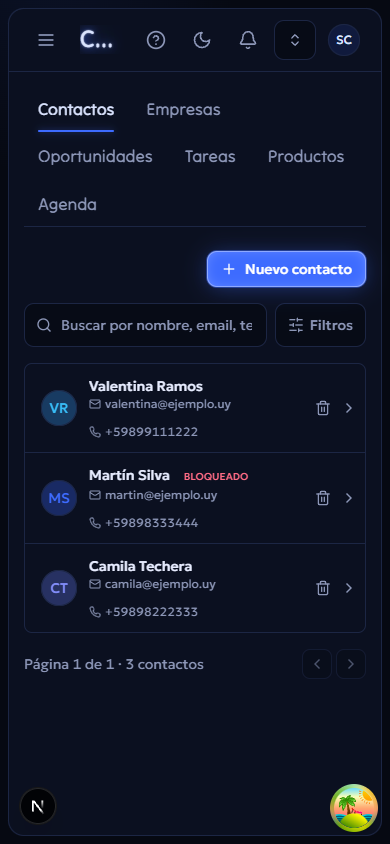
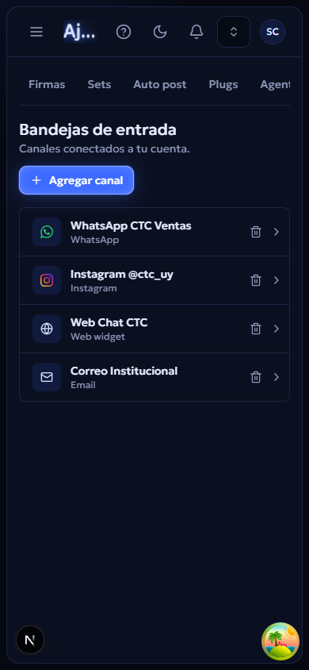
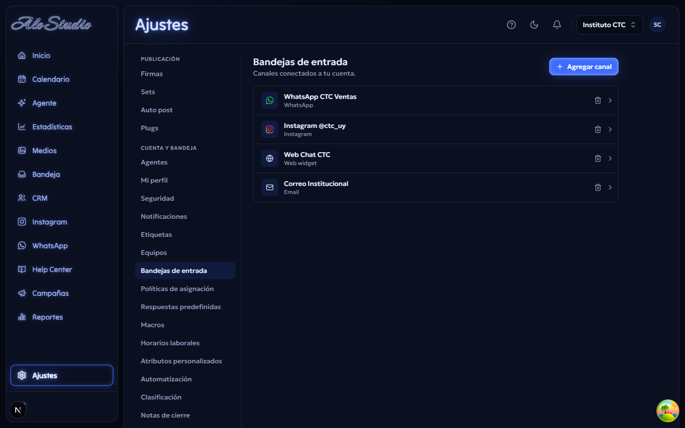

---

### 4. 47 confirmaciones nativas `window.confirm()` y módulo de WhatsApp sin i18n

- **Categoría:** Consistencia visual / Microinteracciones y textos / Multi-idioma.
- **Dónde:**
  - **47 llamadas a `window.confirm()`** en toda la app (ej. `frontend/components/agenda/agenda-view.tsx:152`, `frontend/components/contacts/contacts-view.tsx:340`, `frontend/components/agent/agent-thread-list.tsx:43`, `frontend/components/conversations/conversation-view.tsx:155`, `frontend/components/settings/inboxes/inboxes-view.tsx:106`).
  - **Clave i18n equivocada** al borrar etiquetas: `frontend/components/settings/labels/labels-view.tsx:128` usa `t("instagram.answers.deleteConfirm", ...)` en vez de un texto de etiquetas.
  - **Módulo de WhatsApp completamente hardcodeado en español** (no usa `useT()` en los 7 idiomas): `frontend/components/whatsapp/broadcasts-panel.tsx:125-502`, `frontend/components/whatsapp/business-profile-panel.tsx:21-334`, `frontend/components/whatsapp/catalog-panel.tsx:87-139`, `frontend/components/whatsapp/link-qr-panel.tsx:252`, `frontend/components/whatsapp/templates-panel.tsx:631`.
- **Qué pasa hoy:** Cada acción destructiva abre una ventana gris/blanca del navegador que rompe la estética oscura de vidrio cobalto, bloquea el hilo principal y no permite botones semánticos (`variant="destructive"` vs `variant="secondary"`). Además, usuarios en inglés, portugués o coreano ven todo WhatsApp en español.
- **Cómo resolverlo:** Crear un único `<ConfirmDialog>` nativo con `<dialog>` (usando los tokens del sistema neón, foco inicial en Cancelar y botón destructivo rojo) y migrar las cadenas de `components/whatsapp/*` a `frontend/lib/i18n/messages/{es,en,pt,fr,de,it,ko}/`.

---

## 🟠 Impacto Alto

### 5. Inconsistencias con las reglas de luz de `DESIGN.md` en Inicio y Agente

- **Categoría:** Consistencia con el sistema neón / Jerarquía visual.
- **Dónde:**
  - `frontend/components/overview/account-overview.tsx:170` (segundo `.neon-sign` en la página, a `42px`).
  - `frontend/components/overview/account-overview.tsx:102` y `:130` (`.neon-nav` aplicado a 4 íconos de KPI y 4 íconos de accesos rápidos).
  - `frontend/components/ui/button.tsx:25`, `frontend/components/agent/agent-chat-view.tsx:365`, `frontend/components/agent/agent-composer.tsx:88-97`, `frontend/components/conversations/writing-assist.tsx:112-138`, `frontend/components/shell/help-button.tsx:197-206`.
- **Qué pasa hoy (verificado en `03-inicio-night.png` y `10-agente-night.png`):**
  1. **Doble cartel brillante en Inicio:** la página muestra `"Inicio"` (`34px`) brillando en la barra superior y justo debajo `"Bienvenido"` (`42px`) brillando todavía más fuerte con `.neon-sign`, compitiendo por el mismo foco.
  2. **Violación de *The Humming Sidebar Exception* (`DESIGN.md:197`):** la clase `.neon-nav` (exclusiva de la barra lateral principal) se reutilizó en 8 íconos dentro de tarjetas de Inicio (`LiveCard` y `ActionRow`), poniéndoles halo luminoso a elementos decorativos.
  3. **Violación de *The Electrode Rule* (`DESIGN.md:199`):** el naranja electrodo (`--neon-electrode`, `#ff6a3d`, `<Button variant="ai">`) fue diseñado específicamente para diferenciar acciones de IA, pero tiene **0 usos en toda la aplicación**. Tanto el **Agente** (`10-agente-night.png`), como el botón de **Asistente de escritura IA** (`writing-assist.tsx`) y la **Ayuda IA** usan cobalto o gris neutro, perdiendo una señal visual clave del producto.
- **Cómo resolverlo:**
  - En `account-overview.tsx`: usar `Geologica` `font-medium` sin `.neon-sign` para el saludo (como hace `PageHeader` en `:89`), y reemplazar `.neon-nav` en KPIs/accesos por `text-fg-muted` o un contenedor `bg-focused text-lit` sin halo.
  - Aplicar `variant="ai"` / acento `text-electrode` en el envío del `AgentComposer`, el distintivo `<Sparkles>` de `AgentChatView` y el disparador de `WritingAssist`.

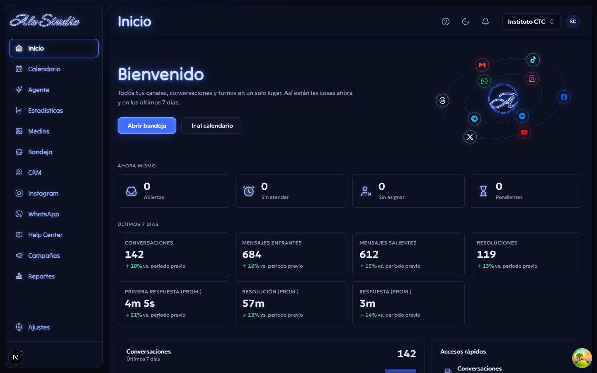
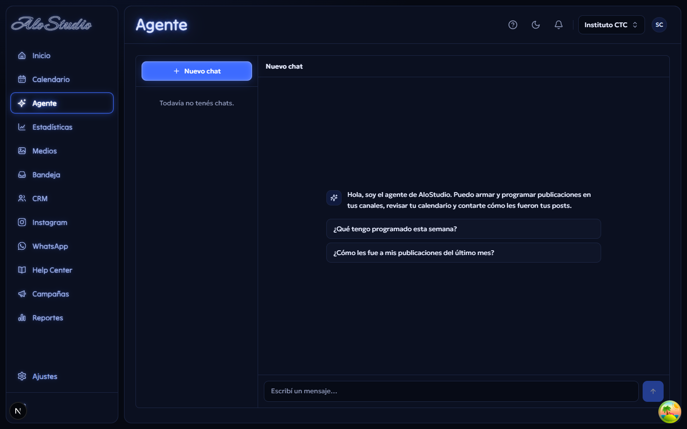

---

### 6. Estados de carga, vacío y error inconsistentes (y fallos silenciosos que muestran "0")

- **Categoría:** Estados vacíos, de carga y de error.
- **Dónde:**
  - `frontend/components/overview/account-overview.tsx:197-206` y `:237-244` (`live.isError` y `series.isError` nunca se muestran).
  - `frontend/components/shell/notification-bell.tsx:114-124` (`list.isError` se muestra como *"No tenés notificaciones."*).
  - `frontend/components/publications/calendar-view.tsx` (`13-calendario-night.png`), `frontend/components/crm/opportunities-view.tsx:141-146`, `frontend/components/agenda/agenda-view.tsx:273-283`, `frontend/components/publications/media-library-view.tsx:165-172`, `frontend/components/agent/agent-chat-view.tsx:340-408`.
- **Qué pasa hoy:**
  - Si falla la consulta de métricas en vivo en **Inicio** o el listado de **Notificaciones**, la interfaz miente mostrando `0` o estado vacío en vez de un aviso de error.
  - Mientras **Inicio** usa skeletons `animate-pulse` (`account-overview.tsx:214`), **Oportunidades**, **Agenda**, **Medios** y **Agente** muestran solo un texto plano centrado (`"Cargando…"`), provocando saltos bruscos de layout (CLS) al cargar.
  - Los estados de error de **Calendario** (`13-calendario-night.png`), **Oportunidades**, **Agenda** y **Medios** muestran solo texto rojo sin botón **"Reintentar"** (`refetch()`), obligando al usuario a recargar toda la pestaña.
  - En contraste, el estado vacío de **Medios** (`media-library-view.tsx:174-201`) está muy bien resuelto (ilustración limpia + texto + CTA primario): conviene tomarlo como patrón compartido (`<EmptyState>` / `<ErrorState onRetry={...}>`).

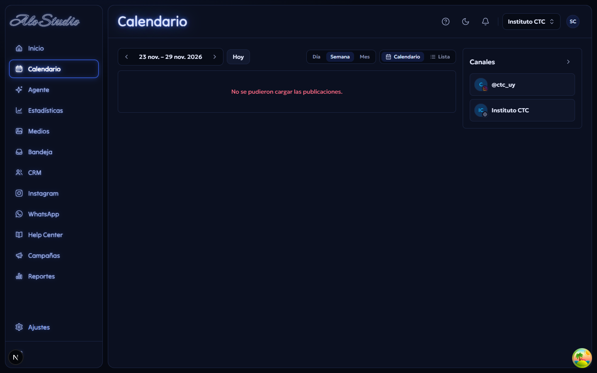

---

### 7. Menús desplegables del topbar que no se cierran al hacer clic afuera ni con `Escape`, y acción borrar oculta en celular

- **Categoría:** Accesibilidad y celular / Microinteracciones.
- **Dónde:**
  - `frontend/components/shell/account-switcher.tsx:25-66` (usa `
` sin listener de clic exterior ni `Escape`).
  - `frontend/components/shell/agent-menu.tsx:37-72` (ídem: queda abierto al tocar cualquier otra zona o apretar `Escape`).
  - `frontend/components/shell/notification-bell.tsx:45-58` y `:230` (cierra con clic exterior pero no con `Escape`; el botón borrar de cada fila usa `opacity-0 group-hover/row:opacity-100`, volviéndolo **invisible en pantallas táctiles**).
  - `frontend/components/shell/help-button.tsx:73-84` (no cierra con `Escape`).
  - `frontend/components/ui/tabs.tsx:80-94` (`role="tab"` sin navegación con flechas `ArrowLeft`/`ArrowRight` ni `aria-controls` según WAI-ARIA).
- **Cómo resolverlo:** Extraer un hook chico `useDisclosureClose(detailsRef, open, setOpen)` que escuche `mousedown` + `keydown (Escape)` para los cuatro menús del topbar, y cambiar `opacity-0 group-hover/row:opacity-100` por `sm:opacity-0 sm:group-hover/row:opacity-100` (siempre visible en dispositivos táctiles).

---

### 8. Objetivos táctiles por debajo de 44×44 px en botones de ícono

- **Categoría:** Accesibilidad y celular (WCAG 2.5.5 / `frontend/DESIGN-SYSTEM.md:140`).
- **Dónde:**
  - `frontend/components/shell/help-button.tsx:324` (`X` para quitar adjunto: `12×12 px`, sin padding).
  - `frontend/components/contacts/contact-photo.tsx:74` (`h-6 w-6` = `24×24 px`).
  - `frontend/components/publications/calendar-view.tsx:271,288,305` (`h-6 w-6` = `24×24 px`).
  - `frontend/components/publications/publication-error-alert.tsx:44` (`h-6 w-6` = `24×24 px`).
  - `frontend/components/conversations/chat-search.tsx:62` (`h-7 w-7` = `28×28 px`).
  - `frontend/components/publications/publication-editor-dialog.tsx:1089,1099,1108` (`h-7 w-7` = `28×28 px`).
  - `frontend/components/settings/inboxes/inboxes-view.tsx:142` y 12 pantallas de Ajustes (`p-1.5` con ícono `h-4 w-4` = `28×28 px`).
- **Cómo resolverlo:** Usar el mismo patrón de pseudo-área táctil que ya tiene `<Button size="icon">` (`after:absolute after:-inset-2 after:content-['']`) o llevar el botón a `min-h-10 min-w-10` en móvil.

---

## 🟡 Impacto Medio

### 9. Tarjetas "Ahora mismo" de Inicio sin acción (callejón sin salida)

- **Categoría:** Experiencia de usuario (`PRODUCT.md` Principio #1: *"nunca a más de un paso"*).
- **Dónde:** `frontend/components/overview/account-overview.tsx:86-114` (`LiveCard`).
- **Qué pasa hoy:** Las 4 métricas más urgentes del día (*Abiertas*, *Sin atender*, *Sin asignar*, *Pendientes*) son `
` estáticos. Cuando una operadora ve `4 Sin atender` o `3 Sin asignar`, su instinto es hacer clic en esa tarjeta para abrir la Bandeja filtrada en ese estado, pero no pasa nada.
- **Cómo resolverlo:** Convertir `LiveCard` en `<Link>` con `Card interactive` apuntando a `/accounts/${accountId}/conversations?status=open`, `?assignee=unassigned`, `?status=pending`, etc.

---

### 10. Geometría y sombras fuera de norma (`rounded-panel` en columnas Kanban y `shadow-lg` en cards)

- **Categoría:** Consistencia con el sistema neón (*The Light-Not-Lift Rule* y §Shapes de `DESIGN.md`).
- **Dónde:**
  - `frontend/components/crm/opportunities-view.tsx:229`: columnas del Kanban usan `rounded-panel` (`16px`), reservado solo para los 2 paneles principales del shell (`DESIGN.md:252`). Deben usar `rounded-md` (`8px`).
  - `frontend/components/whatsapp/business-profile-panel.tsx:80` y `frontend/components/whatsapp/templates-panel.tsx:398`: previews con `rounded-2xl shadow-lg` dentro de paneles estáticos (el `shadow-menu` es exclusivo de popovers y menús).
  - `frontend/components/contacts/custom-attribute-input.tsx:9`, `frontend/components/instagram/manual-connect-form.tsx:94` y `frontend/components/instagram/post-composer.tsx:32`: inputs armados a mano con `bg-surface border-border rounded-md` en vez del componente `<Input>` (`.glass-field`, `bg-field`, `rounded-control`), rompiendo el efecto de campo hundido con foco cobalto.

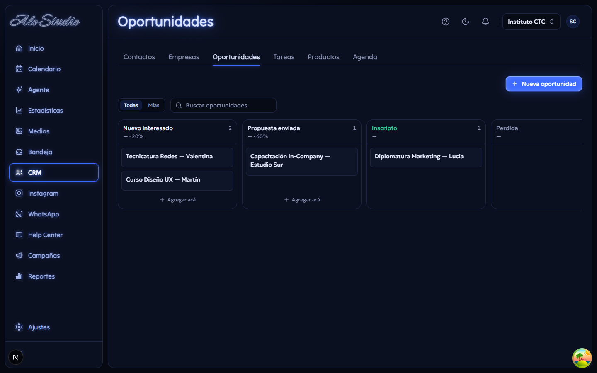

---

### 11. Inconsistencias de textos, voz rioplatense y nomenclatura

- **Categoría:** Microinteracciones y textos (`PRODUCT.md` §Brand Commitments).
- **Dónde:**
  - **Doble nombre para la misma pantalla:** en `frontend/lib/i18n/messages/es/core.ts:18` la barra lateral dice **`Bandeja`**, pero en `frontend/lib/i18n/messages/es/overview.ts:9` el acceso rápido dice **`Conversaciones`** ("Bandeja de entrada") mientras el botón principal arriba dice **`Abrir bandeja`**. Conviene unificar todo en *"Bandeja"*.
  - **Saludo genérico masculino:** `frontend/lib/i18n/messages/es/overview.ts:17` dice `"Bienvenido"` (en un equipo con operadoras mujeres como Sofía y Yamila en CTC). Mejor `"Hola, {name}"` o saludo según la hora (*"Buenos días / Buenas tardes / Buenas noches"*), como tenía la versión anterior.
  - **Mezcla "Email" vs "correo" en Login:** `frontend/lib/i18n/messages/es/core.ts:8` (`"Email"`) junto a `:79` (`"o con tu correo"`) en el mismo formulario.
  - **Anglicismos en la barra lateral y Ajustes:** `frontend/lib/i18n/messages/es/core.ts:22` (`"Help Center"` junto a ítems 100 % en español; debería ser `"Centro de ayuda"`), y en `:144-146` (`"Sets"`, `"Auto post"`, `"Plugs"` sin subtítulo explicativo en la pantalla).
  - **Emoji crudo como ícono:** `frontend/components/shell/help-button.tsx:173` inserta `"📷 "` en el historial de preguntas en vez de un ícono `lucide-react` (`DESIGN-SYSTEM.md:140`).
  - **Texto con error gramatical menor en Agente:** en `10-agente-night.png` (`agent.greeting`) se lee *"contarte cómo les **fueron** tus posts"* (debería ser *"cómo les **fue** a tus posts"*).

---

### 12. Contraste de texto apagado y legibilidad en tarjetas densas

- **Categoría:** Jerarquía, espaciado y contraste.
- **Dónde:**
  - `frontend/components/shell/help-button.tsx:235` (`opacity-80` aplicado sobre `text-fg-muted` `#8d97b8` sobre `#070b16` → baja el contraste por debajo de 4.5:1 para texto de `11px`).
  - `frontend/components/settings/settings-sidebar.tsx:156` (`opacity-60` sobre `text-fg-muted`).
  - `frontend/components/conversations/conversation-list.tsx` (`05-bandeja-night.png`): el bloque de filtros en la columna izquierda de `320px` acumula 4 filas verticales de controles (tabs de asignación + búsqueda + píldoras de estado + 2 `<select>` de canal/bandeja), comiéndose ~220 px de alto antes del primer chat. Compactar los dos `<select>` en una sola fila de 2 columnas o adentro del botón *Filtros* gana 2–3 conversaciones visibles sin scroll.

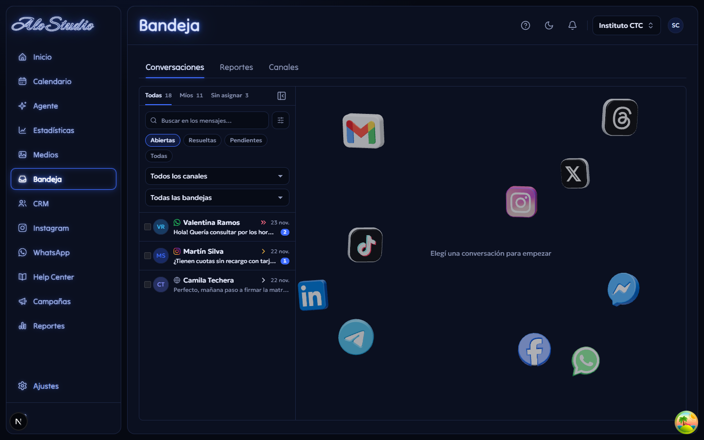

---

## 🟢 Impacto Bajo (pulido)

### 13. Transición ausente en la apertura del cajón móvil y falta de feedback de arrastre táctil en Kanban

- **Dónde:**
  - `frontend/components/shell/dashboard-shell.tsx:203-233`: el cajón lateral móvil se monta/desmonta seco sin animación de entrada (candidato directo para **Anime.js v4**).
  - `frontend/components/crm/opportunities-view.tsx:215-227`: el tablero usa HTML5 Drag & Drop nativo (no funciona en pantallas táctiles); agregar un botón rápido de cambio de etapa en el pie de cada tarjeta mejora el uso en celular.

### 14. Login en escritorio con Google desactivado y espacio aéreo en móvil

- **Dónde:** `frontend/app/(auth)/layout.tsx:12-27` y `frontend/app/(auth)/login/page.tsx:64-158`.
- **Observación:** La pantalla de login (`01-login-night.png` y `02-login-mobile.png`) se ve muy sólida y limpia; los 10 logos 3D en escritorio (y 6 en móvil) acompañan bien sin tapar el formulario. Un detalle menor: `LanguageSwitcher` (`layout.tsx:14`) no tiene borde ni fondo translúcido como `AccountSwitcher`, por lo que en móvil sobre un logo 3D pasando detrás pierde contraste momentáneamente (`bg-surface/80` o `bg-field border border-glass` lo resuelve, evitando el bug de opacidad).

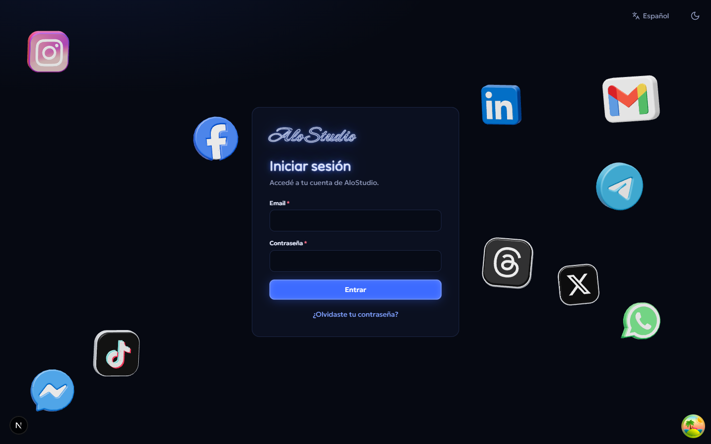
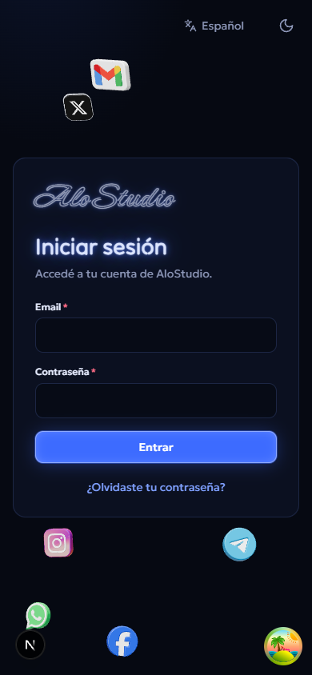

---

## Tabla de prioridades sugerida

| Prioridad | Punto | Esfuerzo | Impacto |
|---|---|---|---|
| **P0** | #1 Fix central de opacidad Tailwind (`<alpha-value>`) | Chico (2 archivos) | Repara 80 bugs visuales en 47 pantallas |
| **P0** | #2 Topbar móvil + posicionamiento `fixed` de popovers | Chico | Destraba lectura y uso real en celular |
| **P0** | #3 Scroll horizontal en `NavTabs` + agrupación de Ajustes | Medio | Elimina tabs rotos en 3 filas y mejora navegación |
| **P1** | #4 `<ConfirmDialog>` compartido + i18n de WhatsApp + fix clave en Labels | Medio | Elimina 47 popups nativos y completa 7 idiomas |
| **P1** | #5 Alinear Inicio y Agente a `DESIGN.md` (Electrode Orange + 1 solo sign) | Chico | Cumple 100 % con las reglas del sistema neón |
| **P1** | #6 `<ErrorState onRetry>` + skeletons consistentes + no ocultar errores como `0` | Medio | Evita silencios engañosos y saltos de layout |
| **P1** | #7 Cierre con clic afuera/`Escape` + borrar visible en móvil + teclado en Tabs | Chico | Accesibilidad WCAG y pulido diario |
| **P2** | #8–#12 Targets táctiles ≥44px, KPIs cliqueables en Inicio, copy unificado, filtros compactos | Chico–Medio | Mejora velocidad diaria de operación |
| **P3** | #13–#14 Animaciones con Anime.js v4 (ver [`propuesta-animejs-v4.md`](./propuesta-animejs-v4.md)) | Medio | Eleva identidad y respuesta táctil |

---

## Ampliación: Cards y paneles de vidrio opaco (vidrio esmerilado) — 2026-11-23

- **Objetivo:** Llevar al resto del panel la estética de vidrio opaco (esmerilado) de la tarjeta de login: fondo translúcido, desenfoque del fondo (`backdrop-filter: blur`), borde fino e iluminación superior sutil con tokens `--neon-*`, tanto en modo claro como en modo oscuro.
- **Implementación central (`frontend/app/globals.css` + `frontend/components/ui/card.tsx`):**
  - Nuevos tokens en `:root` (claro) y `.dark` (oscuro): `--neon-glass-surface`, `--neon-glass-work`, `--neon-glass-card`, `--neon-glass-card-hover`, `--neon-glass-dialog`, `--neon-glass-border`, `--neon-glass-top-light`, `--neon-glass-inner-glow`, `--neon-glass-blur` (`14px`), `--neon-glass-panel-blur` (`18px`) y `--work-canvas-accent`.
  - Fondo ambiental sutil (`--canvas-accent` en `body` + `.glass-work-canvas` en el panel principal de `DashboardShell`) con resplandores cobalto suaves para que el vidrio esmerilado tenga profundidad detrás sin cansar la vista ni bajar el contraste (WCAG AA garantizado en ambos temas).
  - Tres clases reutilizables: `.glass-panel` (login, sidebar, cajón móvil, selector de cuentas), `.glass-card` / `.glass-card-interactive` (componente compartido `<Card>`, `ErrorState`, paneles laterales de Bandeja, columnas Kanban y contenedores de CRM/Agenda/Ajustes/Agente IA/WhatsApp) y `.glass-dialog` (los 11 modales `<dialog>`, popovers del topbar, `CallDock`, `CallButton` y tooltips).
  - **Rendimiento y accesibilidad:** cero `backdrop-filter` en filas de listas largas (conversaciones, mensajes, contactos, etiquetas) ni en el ancestro `.glass-work-canvas` (para no romper `position: fixed` en móvil); fallback automático a fondo sólido `var(--surface)` bajo `@supports not (backdrop-filter: blur(1px))` y `@media (prefers-reduced-transparency: reduce)`.
- **Capturas antes y después en `docs/design-neon/`:**
  - Inicio oscuro: `vidrio-antes-inicio-oscuro.png` → `vidrio-despues-inicio-oscuro.png`
  - Inicio claro: `vidrio-antes-inicio-claro.png` → `vidrio-despues-inicio-claro.png`
  - Inicio móvil oscuro: `vidrio-antes-inicio-mobile-oscuro.png` → `vidrio-despues-inicio-mobile-oscuro.png`
  - CRM Oportunidades (oscuro y claro): `vidrio-antes-crm-oscuro.png` → `vidrio-despues-crm-oscuro.png` y `vidrio-despues-crm-claro.png`
  - Bandeja (paneles laterales): `vidrio-antes-bandeja-oscuro.png` → `vidrio-despues-bandeja-oscuro.png`
  - Diálogo en claro: `vidrio-antes-dialogo-claro.png` → `vidrio-despues-dialogo-claro.png`
  - Reportes y Agente IA: `vidrio-despues-reportes-oscuro.png`, `vidrio-despues-agente-oscuro.png`
