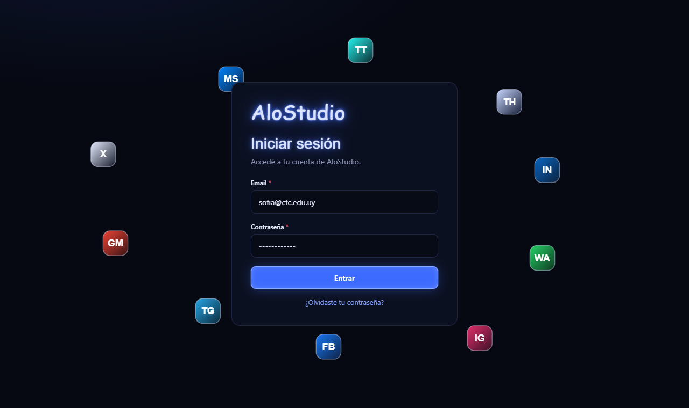
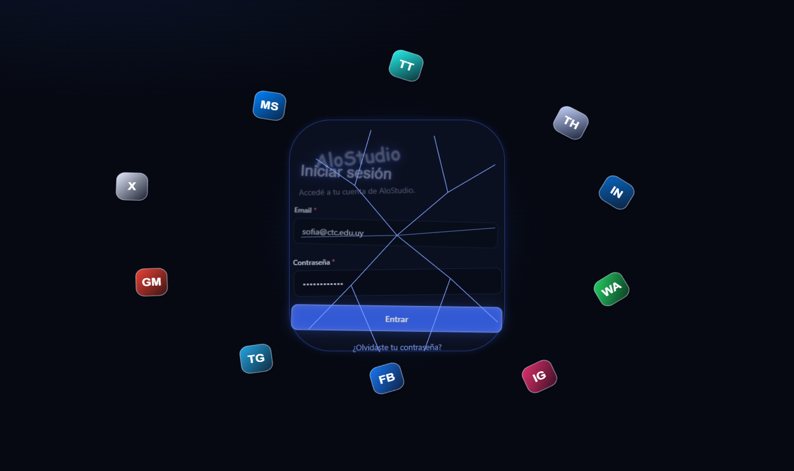
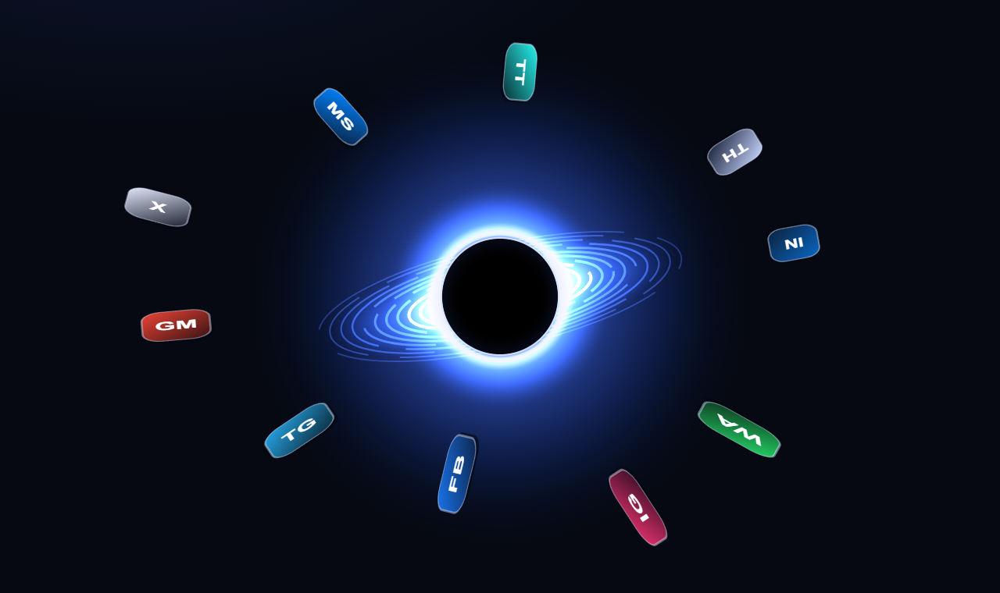
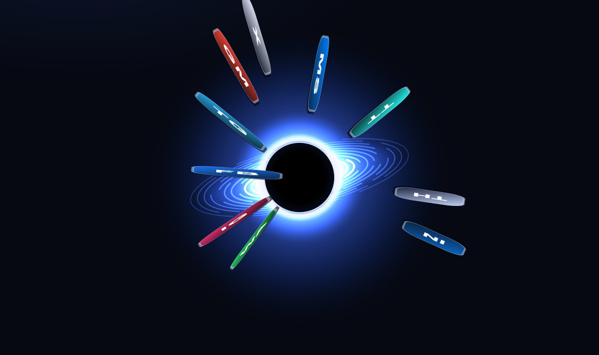
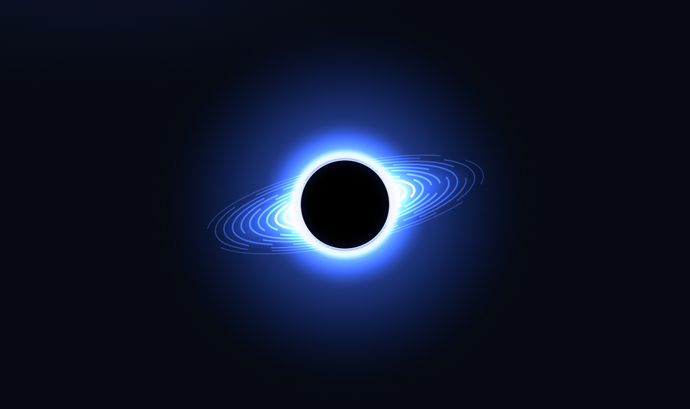

# Propuesta y Prototipo: Login con Agujero Negro

> **Estado:** Boceto + prototipo interactivo listo para revisión del dueño. **No se modificó código de `frontend/` todavía; esperando OK para implementar.**
> **Prototipo interactivo (abrir en el navegador):** [`prototipo-agujero-negro.html`](./prototipo-agujero-negro.html)

---

## 1. Cómo probar el prototipo ahora mismo

Abrí [`docs/neon/prototipo-agujero-negro.html`](./prototipo-agujero-negro.html) directo en Chrome o Edge (funciona sin servidor):

- Hacé clic en **"Entrar"** (o **"▶ Simular login correcto"**) para ver la secuencia completa de **2,6 segundos**.
- Usá la barra deslizante (**scrubber 0 ms → 2600 ms**) para frenar e inspeccionar cualquier instante cuadro por cuadro.
- Probá los conmutadores de la barra inferior:
  - **📱 Celular (390px):** simula exactamente un teléfono con 6 íconos y proporción compacta.
  - **☀ Día / Noche:** muestra cómo funciona sobre tema claro y tema oscuro.
  - **♿ Reduced motion:** muestra la transición simple de `220 ms` que reemplaza la secuencia.

---

## 2. Storyboard cuadro por cuadro (capturas del prototipo)

### 0 ms — Estado de reposo (login normal)
La tarjeta de vidrio cobalto (`420px`) y los logos 3D flotando alrededor (`FloatingLogos`), exactamente como hoy.



### Fase 1 (`0 ms → 750 ms`) — Fractura y caída hacia el centro
Al recibir `200 OK` de `/api/auth/login` (nunca en errores), se precarga el destino con `router.prefetch(target)`. Aparecen grietas de luz cobalto sobre la tarjeta y cada bloque interno (`AloStudio`, título, subtítulo, campos, botón y enlace) se fractura con `Anime.js v4` (`createTimeline` + `stagger`) y cae acelerando hacia el centro mientras el contenedor se contrae.



### Fase 2 (`450 ms → 1450 ms`) — Esfera negra + disco de acreción azul
La tarjeta se vuelve una esfera negra absoluta (`#000000`, horizonte de sucesos) rodeada por un anillo de fotones blanco-cobalto (`#dbe4ff` / `#3d6bff`) y un disco de acreción azul giratorio con lente gravitacional.



### Fase 3 (`520 ms → 1950 ms`) — Íconos 3D estirados como chicle
Los modelos 3D reales de `FloatingLogos` (`whatsapp.glb`, `instagram.glb`, `facebook.glb`, `telegram.glb`, `gmail.glb`, `x.glb`, `messenger.glb`, `tiktok.glb`, `threads.glb`, `linkedin.glb`) abandonan el rebote, entran en espiral acelerada hacia el centro y se **estiran radialmente como chicle** (`scale.x → 4.5`, `scale.y → 0.18`, orientados hacia el horizonte) hasta desaparecer dentro del agujero negro.



### Fase 4 (`1850 ms → 2600 ms`) — Caída de la cámara → Inicio de AloStudio
La cámara acelera hacia el horizonte de sucesos (zoom exponencial + líneas de velocidad radiales), envuelve la pantalla en negro profundo y hace la transición limpia hacia `/accounts/[accountId]` (o `?next=...`).



---

## 3. Plan de implementación técnica (cuando des el OK)

### A. Por qué GLSL + Three.js procedural en vez de un modelo pesado de Blender
- Verificamos el entorno y **Blender no está instalado** en esta máquina.
- Además, para un disco de acreción luminoso que tiene que arrancar en < 100 ms y correr a 60 fps en celular, un **`THREE.ShaderMaterial` GLSL procedural** (con ruido FBM rotatorio, anillo de fotones y arco de lente gravitacional en los tonos exactos `--neon-core` `#3d6bff` y `--neon-lit-text` `#dbe4ff`) pesa **< 4 KB**, no bloquea la red descargando `.glb`/texturas grandes, escala a cualquier DPI y permite animar el progreso de forma continua en sincronía con Anime.js v4.
- Si más adelante preferís sumar una malla o textura horneada en Blender, la escena Three.js queda preparada para reemplazar el shader por un `.glb` sin tocar la orquestación.

### B. Integración limpia en los archivos existentes
1. **Contexto compartido en `frontend/app/(auth)/layout.tsx` (`AuthSingularityProvider`):**
   - Envuelve la tarjeta (`[data-bounce]`) y `<FloatingLogos />` para coordinar el evento `triggerBlackHole(onComplete)` solo cuando el login es exitoso.
   - Expone el centro exacto de la tarjeta (`getBoundingClientRect()`) para que el horizonte nazca exactamente donde está el formulario (en desktop y celular).
2. **Disparo en `frontend/app/(auth)/login/page.tsx`:**
   - Solo entra en la secuencia después de `if (res.ok)` (si las credenciales fallan o hay error de red, no se dispara nada y se muestra la alerta normal).
   - Llama inmediatamente a `router.prefetch(destination)` al iniciar la animación (`t = 0 ms`) para que, al completar los `2.6 s`, la navegación al Inicio sea instantánea y no agregue demora extra.
   - Bloquea doble envío (`submitting` / `entering`) y anuncia a lectores de pantalla un estado accesible (`role="status"` en los 7 idiomas, ej. `auth.login.entering`).
3. **Absorción y estiramiento real sobre los `.glb` en `frontend/components/brand/floating-logos.tsx`:**
   - `FloatingLogos` **ya tiene la jerarquía de grupos perfecta** en las líneas `374–378`:
     ```ts
     const squash = new THREE.Group();
     const unsquash = new THREE.Group();
     unsquash.add(holder);
     squash.add(unsquash);
     ```
   - En modo `singularity`, desactivamos la colisión contra `[data-bounce]` y los bordes, aplicamos aceleración espiral hacia `(cx, cy)`, orientamos `squash.rotation.z = -Math.atan2(cy - b.y, cx - b.x)`, y llevamos `squash.scale` de `(1, 1, 1)` hasta `(4.6, 0.18, 0.45)` (*spaghettification* real sobre los modelos 3D!).
   - En la misma escena WebGL de `FloatingLogos` (sin crear un segundo contexto WebGL, clave para no saturar GPUs móviles), montamos el `Mesh` del horizonte de sucesos + disco de acreción GLSL (inicialmente `visible = false`, cero costo hasta que el login sea correcto).
   - En la fase 4 (`1850 → 2600 ms`), acercamos/escalamos la cámara ortográfica (`camera.zoom` exponencial de `1` a `12`) para el efecto de caída real dentro del agujero negro.
4. **Orquestación DOM con Anime.js v4 (`createTimeline` + `stagger`):**
   - Fractura y succión de los elementos internos de la tarjeta (`[data-bh-shard]`) hacia el centro.
   - Morfología de la tarjeta `.glass-panel` hacia esfera negra (`borderRadius: '50%'`, escala proporcional, borde neón intenso).
   - Limpieza garantizada con `createScope()`.
5. **`prefers-reduced-motion: reduce`, tema claro y celular:**
   - **Reduced motion:** se salta Three.js/fractura y ejecuta solo un `opacity: [1, 0]` suave de `220 ms` + navegación inmediata.
   - **Celular (`< 480px`):** usa los 6 logos existentes en `FloatingLogos`, limita `devicePixelRatio` a `1.5`, desactiva partículas finas extras y acota la duración a `2.4 s`.
   - **Sin WebGL (fallback):** si `WebGLRenderer` falla, la tarjeta igual se fractura y se transforma en esfera negra con un disco de acreción CSS radial + zoom suave, así nunca se rompe el login.
   - **Textos i18n:** cualquier texto accesible nuevo (ej. `auth.login.entering`) se agregará en los 7 idiomas (`es`, `en`, `pt`, `fr`, `de`, `it`, `ko`).

---

## 4. Preguntas / decisiones antes de implementar

1. **¿Te gusta el ritmo de `2,6 s` y el nivel de estiramiento "chicle" de los íconos que se ve en el prototipo?**
2. **¿Preferís el disco de acreción azul cobalto puro (como el prototipo, 100 % fiel a la paleta neón) o con un destello mínimo naranja electrodo en el borde interior?**
3. **¿La fractura de los campos te gusta como bloques completos inclinándose y cayendo al centro (como en el prototipo) o preferís además partículas/chispas cobalto desprendiéndose del borde de la tarjeta?**
